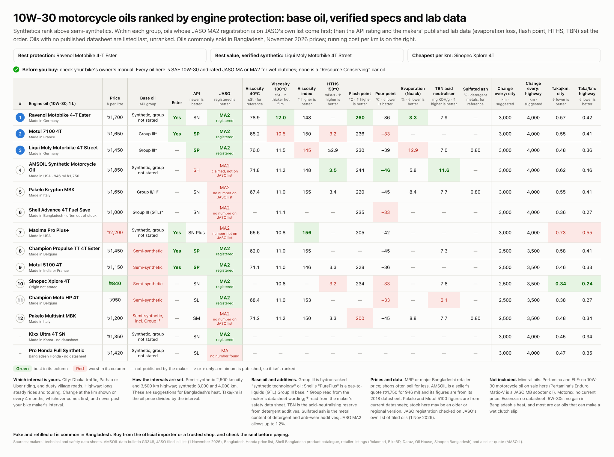

# 10W-30 motorcycle oil rankings (Bangladesh, November 2026)

This repo compares fourteen 10W-30 motorcycle oils that are commonly sold in Bangladesh. All are semi-synthetic or synthetic and rated JASO MA or MA2. The same data is ranked three ways, and each ranking is a single-page PDF plus a 2048 px PNG for social media:

| Ranking | PDF | PNG |
|---|---|---|
| Engine protection (base oil, verified specs, lab data) | [PDF](output/10w30-oils-ranked-by-protection.pdf) | [PNG](output/10w30-oils-ranked-by-protection.png) |
| Performance and sporty feel | [PDF](output/10w30-oils-ranked-by-performance.pdf) | [PNG](output/10w30-oils-ranked-by-performance.png) |
| Value for money (Taka/km) | [PDF](output/10w30-oils-ranked-by-value.pdf) | [PNG](output/10w30-oils-ranked-by-value.png) |

Use the PDF for reading. It is vector, so the small print stays sharp at any zoom.



## What's compared

| Oil | Type | Price (৳/L) | JASO MA2 on JASO's list |
|---|---|---|---|
| Ravenol Motobike 4-T Ester | synthetic, ester | 1,700 | yes |
| Motul 7100 4T | synthetic (Group III), ester | 1,650 | yes |
| Liqui Moly Motorbike 4T Street | synthetic (Group III) | 1,450 | yes |
| AMSOIL Synthetic Motorcycle Oil | synthetic | 1,850 (946 ml ৳1,750) | no, claimed only |
| Pakelo Krypton MBK | synthetic (Group II/III) | 1,650 | no |
| Shell Advance 4T Fuel Save | synthetic (GTL Group III) | 1,080 | no |
| Maxima Pro Plus+ | synthetic, ester | 2,200 | no |
| Champion Propulse TT 4T Ester | semi-synthetic, ester | 1,450 | yes |
| Motul 5100 4T | semi-synthetic, ester | 1,150 | yes |
| Sinopec Xplore 4T | semi-synthetic | 840 | yes |
| Champion Moto HP 4T | semi-synthetic | 950 | yes |
| Pakelo Multisint MBK | semi-synthetic | 1,200 | no |
| Kixx Ultra 4T SN | synthetic | 1,350 | yes (no datasheet) |
| Pro Honda Full Synthetic | synthetic | 1,420 | no number found (no datasheet) |

Every number in the tables comes from the maker's technical or safety data sheet in [`datasheets/`](datasheets). JASO registrations were checked against JASO's filed-oil list of 1 November 2026, which is in [`docs/sources/`](docs/sources).

Left out, with the reason printed on each image:

- Mineral oils.
- Pertamina and ELF: no 10W-30 motorcycle oil on sale in Bangladesh.
- Motorex: no current price.
- Essenza: no datasheet.
- 5W-30s: no gain in Bangladesh's heat, and most are car oils that can make a wet clutch slip.

## How each ranking works

**Engine protection.** Synthetics rank above semi-synthetics. Within each group, oils whose JASO MA2 registration appears on JASO's list come first. After that, the API rating and the published lab data decide the order: Noack evaporation loss, flash point, HTHS viscosity and TBN. This order was set by hand from those rules and is stored as the `rank` field in `src/data.json`. Oils with no datasheet are listed but not ranked.

**Performance and sporty feel.** A datasheet can't measure feel, so each oil gets a sport score out of 7 for formulation features linked to quick revving, smooth shifting and a firm clutch:

| Feature | Points |
|---|---|
| Contains ester | 2 |
| Full-synthetic base | 1 |
| JASO MA2 registration on JASO's list | 1 |
| Viscosity index 150 or more | 1 |
| Viscosity at 40 °C of 70 cSt or less | 1 |
| HTHS 3.3 mPa·s or more | 1 |

Ties go to the full synthetic, then to the higher viscosity index. The scoring is in `sport_score()` in `src/gen.py`, and each oil's score is printed under its name on the image.

**Value for money.** Oils that publish a datasheet *and* appear on JASO's list come first, ordered by city Taka/km. All other oils follow, also ordered by Taka/km.

**Change intervals and Taka/km.** The suggested change intervals for Bangladesh's heat are:

| Oil type | City | Highway |
|---|---|---|
| Semi-synthetic | 2,500 km | 3,500 km |
| Synthetic | 3,000 km | 4,000 km |

Change the oil at that distance or every 4 months, whichever comes first, and never later than the bike maker's interval. Taka/km is the price of 1 litre divided by the interval.

**Cell colours.** In each column the best value is shown in green and the worst in red. Values published only as a minimum (such as "≥2.9") are left out of this comparison, and so are columns where fewer than two oils have a figure.

## How it was made

The work was done in one Claude Code session; the full conversation is in [`docs/conversation.md`](docs/conversation.md). The steps were:

1. **Collect the datasheets.** Each maker's technical data sheet was downloaded, plus the safety data sheet where one gives the base-oil composition. They came from Motul's PIM server, Liqui Moly's PIM API, Maxima's Shopify CDN, Ravenol, Shell LiveDocs, Sinopec, Champion, Pakelo and AMSOIL (data bulletin G3348). The text was extracted with `pdftotext`, and each value was checked against the PDF.
2. **Verify JASO claims.** JASO's filed-oil list (`4T_EV_LIST.pdf` from jalos.or.jp) was searched for every oil. An "MA2" printed on a bottle counts as registered only if the oil's number appears on that list.
3. **Collect prices.** Prices are MRPs or major Bangladeshi retailer prices from November 2026: Rokomari, BikeBD, Daraz, Oil House, Sinopec Bangladesh, the Bangladesh Honda price list and the Shell Bangladesh catalogue. The AMSOIL price is a quote from a seller.
4. **Record the data.** All of it went into `src/data.json`, one object per oil. `null` means the maker doesn't publish that figure.
5. **Render.** Each ranking is turned into HTML and printed to PDF and PNG with headless Chrome (details in the next section).

## Regenerating the images

Requirements: Python 3 (standard library only), Google Chrome or Chromium, and ImageMagick 7 (`magick`).

```sh
./src/render.sh
# on Linux, point it at Chromium:
CHROME=chromium ./src/render.sh
```

The script runs three steps:

1. `src/gen.py` creates three variants (protection, performance and value) from `src/data.json`. Each variant has its own ordering, title, intro and three "picks".
2. `src/build.py` turns each variant into an HTML table using `src/template.html`. It also works out each oil's change intervals and Taka/km, and which cells to colour green or red.
3. Headless Chrome prints each HTML page to a single-page PDF; the template sets the `@page` size to fit the content. Chrome also takes a 2× screenshot, which ImageMagick trims, pads and resizes to 2048 px wide.

Intermediate files go in `build/`, which git ignores.

To update a price or add an oil, edit `src/data.json` and run the script again. In the value and performance rankings, the order and picks update automatically. The protection order follows each oil's `rank` field, so set that by hand.

## Layout

```
output/      the three rankings as PDF and PNG
src/         data.json, gen.py, build.py, template.html, render.sh
datasheets/  makers' technical and safety data sheets, by brand
docs/        conversation.md and the JASO filed-oil list
```

## Caveats

- Prices change and fake or refilled oil is common in Bangladesh. Buy from the official importer or a trusted shop, and check the seal.
- AMSOIL's figures come from its 2018 data bulletin. The Pakelo and Motul 5100 figures come from current datasheets, but stock in Bangladesh may be an older or regional version.
- The sport score is a proxy. It ranks formulation features, not measured riding feel.
- Always check your bike's owner's manual for the required grade and specification.

The datasheets are the makers' own published documents. They are kept here as evidence for the figures, and their copyright stays with the makers.
