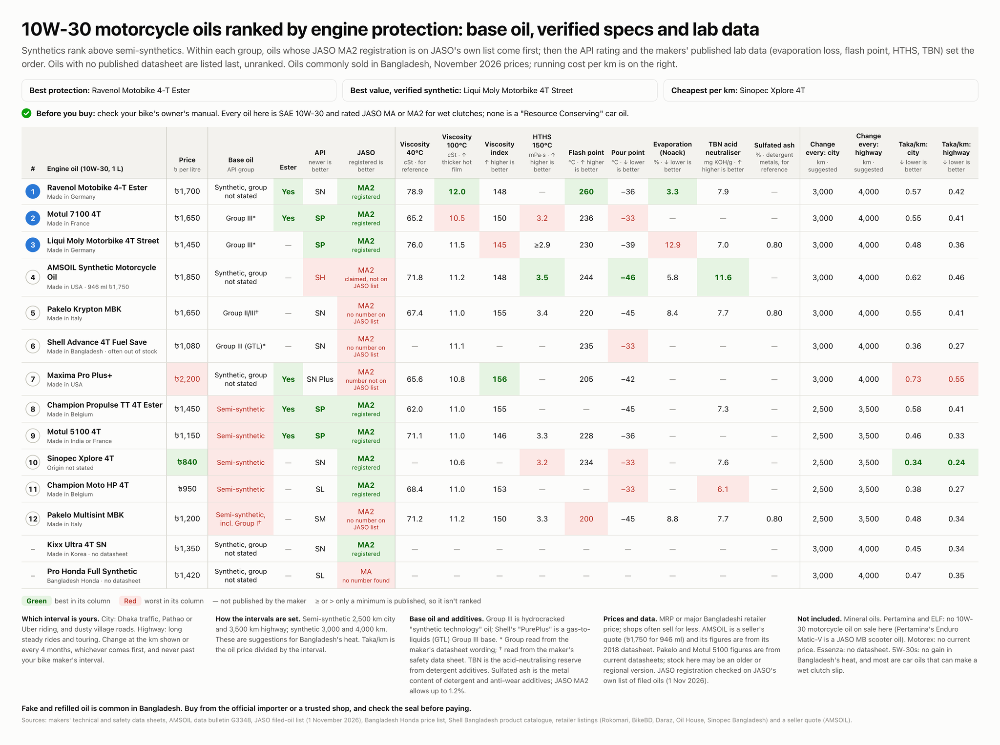

# Engine oil rankings (Bangladesh)

This project compares engine oils sold in Bangladesh, using the makers' datasheets and JASO's filed-oil list. Each grade is ranked three ways: engine protection, performance and sporty feel, and value for money.

**Website: https://habibium.github.io/engine-oil-rankings/** On the site you can switch vehicle, grade and ranking, filter by oil type, search, and sort any column in ascending or descending order.

So far it covers **10W-30 motorcycle oils**: fourteen semi-synthetic and synthetic oils rated JASO MA or MA2, with prices from November 2026. Other motorcycle grades, such as 10W-40 and 5W-30, can be added as more data files without changing any code (see [Adding a grade](#adding-a-grade)). Car oils fit the same structure but need their own columns and ranking rules (see [Car oils](#car-oils)).

If you find this useful, please ⭐ star the repo.

## 10W-30 motorcycle rankings as files

Each ranking is a single-page PDF, which stays sharp at any zoom, and a 2048 px PNG for social media.

| Ranking | PDF | PNG |
|---|---|---|
| Engine protection (base oil, verified specs, lab data) | [PDF](output/motorcycle-10w30-oils-ranked-by-protection.pdf) | [PNG](output/motorcycle-10w30-oils-ranked-by-protection.png) |
| Performance and sporty feel | [PDF](output/motorcycle-10w30-oils-ranked-by-performance.pdf) | [PNG](output/motorcycle-10w30-oils-ranked-by-performance.png) |
| Value for money (Taka/km) | [PDF](output/motorcycle-10w30-oils-ranked-by-value.pdf) | [PNG](output/motorcycle-10w30-oils-ranked-by-value.png) |



## What's compared (10W-30 motorcycle oils)

| Oil | Type | Price (৳/L) | JASO MA2 on JASO's list |
|---|---|---|---|
| Ravenol Motobike 4-T Ester | synthetic, ester | 1,700 | yes |
| Motul 7100 4T | synthetic (Group III), ester | 1,650 | yes |
| Liqui Moly Motorbike 4T Street | synthetic (Group III) | 1,450 | yes |
| AMSOIL Synthetic Motorcycle Oil | synthetic | 1,850 (946 ml ৳1,750) | no, claimed only |
| Pakelo Krypton MBK | synthetic (Group II/III) | 1,650 | no |
| Shell Advance 4T Fuel Save | synthetic (GTL Group III) | 1,080 | no |
| Maxima Pro Plus+ | synthetic, ester | 2,200 | no |
| Champion Propulse TT 4T Ester | semi-synthetic, ester | 1,450 | yes |
| Motul 5100 4T | semi-synthetic, ester | 1,150 | yes |
| Sinopec Xplore 4T | semi-synthetic | 840 | yes |
| Champion Moto HP 4T | semi-synthetic | 950 | yes |
| Pakelo Multisint MBK | semi-synthetic | 1,200 | no |
| Kixx Ultra 4T SN | synthetic | 1,350 | yes (no datasheet) |
| Pro Honda Full Synthetic | synthetic | 1,420 | no number found (no datasheet) |

Every number comes from the maker's technical or safety data sheet in [`datasheets/`](datasheets). JASO registrations were checked against JASO's filed-oil list of 1 November 2026, which is in [`docs/sources/`](docs/sources).

Left out, with the reason printed on each image:

- Mineral oils.
- Pertamina and ELF: no 10W-30 motorcycle oil on sale in Bangladesh.
- Motorex: no current price.
- Essenza: no datasheet.
- 5W-30s: no gain in Bangladesh's heat, and most are car oils that can make a wet clutch slip.

## How each ranking works

**Engine protection.** Synthetics rank above semi-synthetics. Within each group, oils whose JASO MA2 registration appears on JASO's list come first. After that, the API rating and the published lab data decide the order: Noack evaporation loss, flash point, HTHS viscosity and TBN. This order is set by hand from those rules and stored as `protection_rank` in the grade's data file. Oils with no datasheet are listed but not ranked.

**Performance and sporty feel.** A datasheet can't measure feel, so each oil gets a sport score out of 7 for formulation features linked to quick revving, smooth shifting and a firm clutch:

| Feature | Points |
|---|---|
| Contains ester | 2 |
| Full-synthetic base | 1 |
| JASO MA2 registration on JASO's list | 1 |
| Viscosity index 150 or more | 1 |
| Viscosity at 40 °C of 70 cSt or less | 1 |
| HTHS 3.3 mPa·s or more | 1 |

Ties go to the full synthetic, then to the higher viscosity index. The scoring is `sport_score()` in [`src/rankings.py`](src/rankings.py).

**Value for money.** Oils that publish a datasheet *and* appear on JASO's list come first, ordered by city Taka/km. All other oils follow, also ordered by Taka/km.

**Change intervals and Taka/km.** The suggested intervals for Bangladesh's heat are:

| Oil type | City | Highway |
|---|---|---|
| Semi-synthetic | 2,500 km | 3,500 km |
| Synthetic | 3,000 km | 4,000 km |

Change the oil at that distance or every 4 months, whichever comes first, and never later than the bike maker's interval. Taka/km is the price of 1 litre divided by the interval.

**Cell colours.** In each column the best value is shown in green and the worst in red. Values published only as a minimum (such as "≥2.9") are left out of this comparison, and so are columns where fewer than two oils have a figure.

## How it was made

The work was done in one Claude Code session; the full conversation is in [`docs/conversation.md`](docs/conversation.md). The steps were:

1. **Collect the datasheets.** Each maker's technical data sheet was downloaded, plus the safety data sheet where one gives the base-oil composition. They came from Motul's PIM server, Liqui Moly's PIM API, Maxima's Shopify CDN, Ravenol, Shell LiveDocs, Sinopec, Champion, Pakelo and AMSOIL (data bulletin G3348). The text was extracted with `pdftotext`, and each value was checked against the PDF.
2. **Verify JASO claims.** JASO's filed-oil list (`4T_EV_LIST.pdf` from jalos.or.jp) was searched for every oil. An "MA2" printed on a bottle counts as registered only if the oil's number appears on that list.
3. **Collect prices.** Prices are MRPs or major Bangladeshi retailer prices from November 2026: Rokomari, BikeBD, Daraz, Oil House, Sinopec Bangladesh, the Bangladesh Honda price list and the Shell Bangladesh catalogue. The AMSOIL price is a quote from a seller.
4. **Record the data.** Everything went into `data/motorcycle-10w-30.json`, one object per oil. `null` means the maker doesn't publish that figure.
5. **Rank and render.** `src/rankings.py` works out the intervals, Taka/km, sport scores, the three orderings and the green and red cells. The PDF/PNG images and the website both use it, so they always agree.

## Project layout

```
data/        one JSON file per vehicle and grade (motorcycle-10w-30.json); the only files you edit to change data
src/
  rankings.py       shared logic: intervals, Taka/km, sport score, orderings, best/worst cells
  columns.json      table columns, units and which direction is better
  build_images.py   writes one HTML page per grade and ranking from template.html
  render.sh         prints those pages to output/*.pdf and output/*.png
  build_site.py     builds the website into a folder (site/ + data + downloads)
site/        the website: index.html, style.css, app.js (no framework, no build step)
output/      generated PDFs and PNGs, committed so they can be linked and shared
datasheets/  makers' technical and safety data sheets, by brand
docs/        conversation.md and the JASO filed-oil list
.github/workflows/pages.yml   builds and deploys the website on every push to main
```

## Regenerating

**Images.** You need Python 3 (standard library only), Google Chrome or Chromium, and ImageMagick 7 (`magick`).

```sh
./src/render.sh                   # writes output/<vehicle>-<grade>-oils-ranked-by-<ranking>.{pdf,png}
CHROME=chromium ./src/render.sh   # on Linux
```

Headless Chrome prints each page to a single-page PDF; the template sets the `@page` size to fit the content. Chrome also takes a 2× screenshot, which ImageMagick trims, pads and resizes to 2048 px wide.

**Website.** Pushing to `main` deploys it automatically. To preview locally:

```sh
python3 src/build_site.py build/site
python3 -m http.server -d build/site 8000   # then open http://localhost:8000
```

The site loads `data/grades.json` and then the JSON for the selected grade. All values, sort keys and cell colours are worked out in Python at build time, so `app.js` only displays, filters and sorts them. The current view is stored in the URL (for example `#grade=motorcycle-10w-30&rank=value&sort=price&dir=asc`), so a sorted or filtered table can be shared as a link.

## Adding a grade

1. Copy `data/motorcycle-10w-30.json` to, say, `data/motorcycle-10w-40.json`.
2. Set `grade` to `"10W-40"` (keep `category` as `"motorcycle"`), then update `updated`, `notes`, `sources` and the `oils` list.
3. Fill in each oil's fields. Use `null` for any figure the maker doesn't publish; `"≥2.9"`-style strings are fine for minimum-only values. Set `type` to `synthetic`, `semi` or `mineral`, and `protection_rank` to an order following the protection rules (or `null` for oils without a datasheet).
4. Put the datasheets in `datasheets/<brand>/` and list their paths in `datasheets`.
5. Run `./src/render.sh` and commit. The website picks up the new grade automatically and shows it in the Grade switch.

### Car oils

A data file with `"category": "car"` is shown under a Vehicle switch, which appears once there is more than one category. The columns and ranking rules in `src/columns.json` and `src/rankings.py` are written for motorcycles, though: JASO MA/MA2 for wet clutches, and a sport score. Car oils would need their own, based on API SP/ILSAC and ACEA approvals and the car makers' approvals (VW, MB, BMW). The natural next step is to make the columns and rules depend on `category`.

To correct a price or a value, edit the data file and open a pull request, or [open an issue](https://github.com/habibium/engine-oil-rankings/issues) with a source.

## Caveats

- Prices change and fake or refilled oil is common in Bangladesh. Buy from the official importer or a trusted shop, and check the seal.
- AMSOIL's figures come from its 2018 data bulletin. The Pakelo and Motul 5100 figures come from current datasheets, but stock in Bangladesh may be an older or regional version.
- The sport score is a proxy. It ranks formulation features, not measured riding feel.
- Always check your bike's owner's manual for the required grade and specification.

## Licence

- **Code** (`src/`, `site/`, `.github/`) is under the [MIT License](LICENSE).
- **Data, rankings and images** (`data/`, `output/`, and the write-ups in this README and `docs/conversation.md`) are under [Creative Commons Attribution 4.0](LICENSE-DATA). You can share and adapt them, including commercially, as long as you credit this project and link back to it.
- **Third-party documents** are not covered by either licence. The makers' datasheets in `datasheets/` and JASO's list in `docs/sources/` are their owners' copyright and are included only as evidence for the figures.
